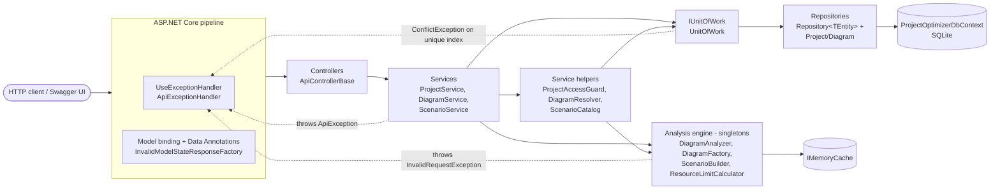
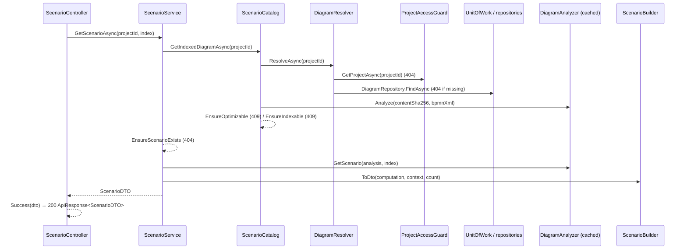

# Architecture

## Projects

| Project | Kind | Depends on | Contains |
|---|---|---|---|
| `ProjectOptimizerAPI` | ASP.NET Core web project (`Microsoft.NET.Sdk.Web`) | `ProjectOptimizerLib` | Controllers, services, repositories, unit of work, DbContext, EF configurations, migrations, Mapster configs, exception handler, the diagram analysis engine (`Lib/Analysis`) |
| `ProjectOptimizerLib` | Class library, no package references | – | DTOs (`DTO/`), enums (`Enum/`), EF entity POCOs (`Model/`), the frontend JSON format (`Model/Process/`) |
| `ProjectOptimizerTests` | xUnit test project | both | Unit tests (analysis engine and services) and integration tests (HTTP through `WebApplicationFactory<Program>`) |

`ProjectOptimizerLib` has no package dependency. Its only attributes are `System.ComponentModel.DataAnnotations`
attributes, one custom attribute (`TrimmedStringLengthAttribute`), and the `System.Text.Json` attributes that map the
frontend's property names in `Model/Process/`. That is why both the API and the tests can
reference the contract types without pulling in EF Core or ASP.NET Core.

## Layers and their rules



| Layer | Folder | May use | Must not |
|---|---|---|---|
| Controller | `ProjectOptimizerAPI/Controllers` | one `I*Service`, `ApiControllerBase.Success/Created`, `NoContent()`, `File(...)` | touch repositories, the DbContext, entities, `try/catch`, `ModelState.IsValid` |
| Service | `Lib/Service` | `IUnitOfWork`, the service helpers, the analysis interfaces, `TimeProvider`, Mapster | touch `HttpContext`, `IActionResult` or the DbContext |
| Service helper | `Lib/Service` (`ProjectAccessGuard`, `DiagramResolver`, `ScenarioCatalog`) | `IUnitOfWork`, analysis interfaces | return DTOs to controllers directly |
| Unit of work | `Lib/Collection/UnitOfWork.cs` | the two repositories and the DbContext | contain business rules |
| Repository | `Lib/Repository` | `ProjectOptimizerDbContext`, Mapster `ProjectToType<T>()` | contain business rules (except throwing `NotFoundException` for a required row) |
| Analysis engine | `Lib/Analysis` (+ records in `Lib/Analysis/Model`) | other analysis interfaces, `IMemoryCache`, DTO types for its output | touch the database or the HTTP context |

All contracts (`I*Service`, `I*Repository`, `IUnitOfWork`, the analysis interfaces and the helper interfaces) are in
`Lib/Interface`.

## Request flow for an analysis request

The sequence below shows `GET /api/projects/{projectId}/scenarios/{index}`, which uses every layer.



## Cross-cutting concerns

### Response envelope

Every JSON response uses `ProjectOptimizerLib.DTO.ApiResponse` or `ApiResponse<TData>`:

| Property | Type | Content |
|---|---|---|
| `data` | `TData?` | Only on `ApiResponse<TData>`; the payload |
| `statusCode` | `int` | The HTTP status code repeated |
| `message` | `string` | `"Success"` for 2xx; the error message otherwise |
| `date` | `DateTime` | `DateTime.UtcNow` when the envelope was created |
| `errors` | `IDictionary<string, string[]>?` | Field → messages for model-validation failures; `null` otherwise |

`System.Text.Json` writes the derived property `data` first and keeps `null` properties. A real response looks like
this:

```json
{ "data": { "orderingVersion": 1, "count": 2 }, "statusCode": 200, "message": "Success", "date": "2026-10-10T19:15:05.1036644Z", "errors": null }
```

`ApiResponseFactory` (`Lib/Helper`) is the only place that builds envelopes. It has three methods: `Success`,
`Error` and `ValidationError`. The responses that have no envelope are the 204 responses, the `.bpmn` download
(raw `application/xml`) and the empty 404 that routing returns when a route constraint does not match.

### Validation

There are two levels of validation:

- **Formal** validation uses Data Annotations on the DTOs, the `[Range]` attribute on the `index` route parameter,
  and enum binding. It runs automatically before the action and produces 400 with
  `"One or more validation errors occurred."` and an `errors` dictionary.
- **Business** validation uses guard methods in the services, helpers and parser. They throw `ApiException`
  subclasses.

[validation-and-errors.md](validation-and-errors.md) has the full rule list.

### Errors

Three exception types carry a status code: `InvalidRequestException` (400), `NotFoundException` (404) and
`ConflictException` (409). `ApiExceptionHandler` (`IExceptionHandler`) is registered with
`AddExceptionHandler<ApiExceptionHandler>()` and activated by `app.UseExceptionHandler()`. It translates exceptions
in one place:

- `ApiException` → its status code and message.
- `BadHttpRequestException` → its own status code, with the message `"The request body is too large."` for 413 and
  `"The request is malformed."` otherwise.
- Any other exception → 500 `"An unexpected error occurred."`.

It logs 4xx results as warnings (status code and message only) and 5xx results as errors (with the exception).

### Mapping

Mapster `IRegister` classes in `Lib/Mapping` are found by
`TypeAdapterConfig.GlobalSettings.Scan(Assembly.GetExecutingAssembly())` in `AddMappings()`. Repositories project
with `ProjectToType<T>()`. Mappings that need no configuration (`Diagram` → `DiagramDTO` / `DiagramSummaryDTO`) work by convention.

### Time

A singleton `TimeProvider.System` is injected into the services. `TimeProviderExtensions.UtcNow()`
returns `GetUtcNow().UtcDateTime`. Tests replace it with `FakeTimeProvider`. All timestamps are UTC `DateTime`.

### Decimal values

Durations and costs are `decimal`. `DecimalNormalizer.Normalize` (`value / 1.0000000000000000000000000000m`) removes
trailing zeros from every value that the analysis engine produces. As a result, values computed per request (for
example `totalCost` in a scenario) serialise without a fraction, such as `25000`. Values read back from SQLite
(`maxCost` and `maxDurationBound` on project DTOs) are not normalised again and serialise as stored, such as
`25000.0`.

### Caching

`AddAnalysisComponents()` registers one `IMemoryCache` with `SizeLimit = 200 000`. Only `DiagramAnalyzer` writes to
it. [services.md](services.md#caching) describes the keys, sizes and expirations.

### CORS

`AddCorsPolicy` registers the policy `Frontend` with the origins from `Cors:AllowedOrigins`, the headers
`Authorization` and `Content-Type`, and any method. The Development settings allow `http://localhost:5173` and
`http://localhost:3000`. The base `appsettings.json` allows no origins.

### Authentication

There is none in phase 1. `app.UseAuthorization()` is in the pipeline, but no `[Authorize]` attribute and no scheme
exist.

## Design decisions

The decisions below come from `.workflow/blueprint.json` and match the code. The places where the blueprint and the
code differ are listed in [validation-and-errors.md](validation-and-errors.md#known-differences-from-the-blueprint).

| Topic | Decision | Reason |
|---|---|---|
| Delivery phase | Only phase 1 (spec doc 09 §9.1–9.2) is built. Users/auth, ownership and optimization are not implemented. | Binding user note. |
| Authentication | None. All endpoints are anonymous; there is no User entity and no JWT. | Phase-1 deviation table. |
| Project names | No owner. Names are unique **globally**, compared trimmed and upper-cased (`NormalizedName`) and backed by a unique index. | BR-04 as changed for phase 1. |
| Single project guard | Every project-scoped request goes through `IProjectAccessGuard`. | Phase 2 only has to add the owner condition there (spec 09 §9.4). |
| Diagram storage | Exactly one `Diagram` row per project (primary key = `ProjectId`) that stores the XML verbatim (a JSON save is converted to XML first), its SHA-256 hash, size, validation summary and the planned limits. Saving overwrites the row in place; there is no revision history and no optimistic-concurrency check (last write wins). | Simplification of spec 01 §1.5, 04 §4.2. |
| Analysis components | Pure, stateless algorithms in `Lib/Analysis`, registered as singletons; in-memory records in `Lib/Analysis/Model`. | Spec 04 §4.3/§4.9. |
| Parse issues vs. validator issues | The parser reports DV-01, 04, 05, 09, 16. The validator adds the other codes and sorts all issues by code, element id and message. Issues are not exposed by an endpoint; the diagram stores only its error and warning counts and `IsOptimizable`. | One owner per code; deterministic output (NFR-18). |
| Hard rejections | Only XML that is too large, has too many flow nodes, is not well-formed, has a DTD, or has a non-BPMN root is rejected (400). Every DV issue is only reported and never blocks a save (BR-09). | Spec 01 §1.6–1.8; XXE protection. |
| Decimal values | `decimal` everywhere, parsed with the invariant culture and normalised. | Byte-identical output (NFR-18). |
| Structure tree | Single-entry single-exit decomposition (`ProcessStructureAnalyzer`). A split's join is its immediate post-dominator. The scenario count is a `BigInteger`. | Spec 01 §1.7 DV-12/13, 08 §8.3. |
| Scenario ordering version 1 | Mixed-radix unranking with the last child as the least significant digit. Exclusive branches are consecutive blocks. Inclusive subsets are ordered by size, then lexicographically. Keys look like `gatewayId=t1+t2;…`. | Spec 02 §2.5, 08 §8.3. |
| Scenario contents | Built from the parsed graph. CPM runs on events, gateways and tasks. | Spec 08 §8.4. |
| Scenario list | `GET …/scenarios` returns every full `ScenarioDTO` in index order, without paging. Above `AnalysisLimits.MaxListedScenarios` (1000) it answers 409; clients then request scenarios one by one. | Keeps the response size bounded. |
| Resource limits | A dynamic program over the structure tree. Limits are recomputed per request; the planned `maxCost` and `maxDurationBound` are also stored on the diagram at save time (FR-72). | Spec 08 §8.6. |
| Caching | One size-limited `IMemoryCache`. Entries are keyed by content hash, so identical XML in any project shares them, and an overwritten diagram simply stops being looked up. | Spec 08 §8.5. |
| Check order on scenario endpoints | formal 400 → 404 project → 404 diagram missing → 409 diagram errors → 409 too many scenarios → 404 index ≥ count. | Spec 04 §4.7. |
| Delete behaviour | Project → diagram cascades (hard delete). | BR-16. |
| Request body limit | `[RequestSizeLimit(3 MiB)]` on both save actions. A framework 413 is mapped to an envelope instead of a 500. | NFR-08. |
| Enums | Serialised as strings (`JsonStringEnumConverter`), stored as strings (`HasConversion<string>()`), and validated with `[EnumDataType]`. | VAL-12/14/60. |
| HTTP caching headers (NFR-19) | Not built. | Optional in the specification. |
| Timestamps | UTC `DateTime` from `TimeProvider`. | Testability. |
| OpenAPI | Swashbuckle, Development only, at `/swagger`, with XML comments and no security definition. | SDK 8 (`openApiMode = swashbuckle`). |
