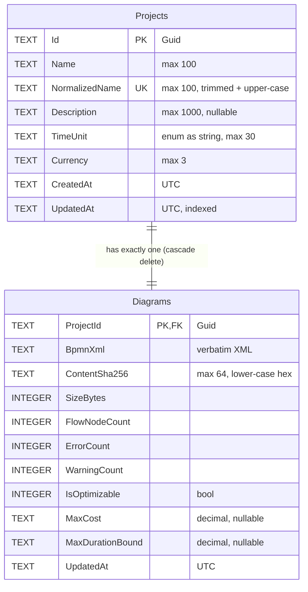

# Database

## Provider and connection

The database is **SQLite**, accessed through `Microsoft.EntityFrameworkCore.Sqlite` 8.0.31. The connection string
`ConnectionStrings:DefaultConnection` in `appsettings.json` is `Data Source=projectoptimizer.db`.
`ServiceCollection.AddDatabase` reads it by name.

The path is relative to the process's working directory. With `dotnet run --project ProjectOptimizerAPI` the file
is created as `ProjectOptimizerAPI/projectoptimizer.db` (plus `-shm` / `-wal` files while the app runs). `*.db*`
files are git-ignored.

`ProjectOptimizerDbContext` exposes `Projects` and `Diagrams`, and applies every
`IEntityTypeConfiguration<T>` from the assembly.

## Entity relationship diagram



## Tables

### Projects (`ProjectConfiguration`)

| Column | CLR type | SQLite type | Null | Max length | Notes |
|---|---|---|---|---|---|
| `Id` | `Guid` | TEXT | no | – | Primary key `PK_Projects` |
| `Name` | `string` | TEXT | no | 100 | Trimmed display name |
| `NormalizedName` | `string` | TEXT | no | 100 | `Name.Trim().ToUpperInvariant()`; unique index `IX_Projects_NormalizedName` (BR-04, global) |
| `Description` | `string?` | TEXT | yes | 1000 | |
| `TimeUnit` | `ETimeUnit` | TEXT | no | 30 | `HasConversion<string>()` → `Minutes` / `Hours` / `Days` / `Weeks` |
| `Currency` | `string` | TEXT | no | 3 | ISO 4217 code |
| `CreatedAt` | `DateTime` | TEXT | no | – | UTC |
| `UpdatedAt` | `DateTime` | TEXT | no | – | UTC; index `IX_Projects_UpdatedAt` (default list order) |

Navigation: `Diagram` (`Diagram`, exactly one).

### Diagrams (`DiagramConfiguration`)

One row per project. Saving a diagram updates this row in place; no history is kept.

| Column | CLR type | SQLite type | Null | Max length | Notes |
|---|---|---|---|---|---|
| `ProjectId` | `Guid` | TEXT | no | – | Primary key `PK_Diagrams` and FK `FK_Diagrams_Projects_ProjectId` (one-to-one with `Project.Diagram`), **ON DELETE CASCADE** |
| `BpmnXml` | `string` | TEXT | no | – | Stored verbatim |
| `ContentSha256` | `string` | TEXT | no | 64 | Cache key of the analysis |
| `SizeBytes` | `int` | INTEGER | no | – | UTF-8 byte count |
| `FlowNodeCount` | `int` | INTEGER | no | – | |
| `ErrorCount` | `int` | INTEGER | no | – | |
| `WarningCount` | `int` | INTEGER | no | – | |
| `IsOptimizable` | `bool` | INTEGER | no | – | No `Error` issue |
| `MaxCost` | `decimal?` | TEXT | yes | – | Planned basis; `null` when not optimizable (FR-72) |
| `MaxDurationBound` | `decimal?` | TEXT | yes | – | Planned basis; `null` when not optimizable (FR-72) |
| `UpdatedAt` | `DateTime` | TEXT | no | – | UTC; time of the last save |

### Delete behaviour

| Relationship | Behaviour | Rule |
|---|---|---|
| Project → Diagram | Cascade (database FK + EF configuration) | BR-16 |

No entity uses soft delete.

### Storage notes

- **Decimals** are stored as TEXT by the SQLite provider. No decimal column is filtered or sorted in SQL.
- **`DateTime`** values are written as UTC and read back with `DateTimeKind.Unspecified`. Timestamps loaded from
  the database therefore serialise without the `Z` suffix (for example `"2026-10-10T19:14:26.6588775"`), while the
  envelope `date` has it.
- **Enums.** Only `Projects.TimeUnit` is an enum column, stored as a string.

## Migrations

| Migration | Content |
|---|---|
| `20261012193947_InitialCreate` | Creates `Projects` and `Diagrams`, the cascade foreign key `FK_Diagrams_Projects_ProjectId`, and the two indexes `IX_Projects_NormalizedName` (unique) and `IX_Projects_UpdatedAt` |

`ProjectOptimizerDbContextModelSnapshot.cs` is the current model snapshot. The application never calls
`EnsureCreated`. On startup, `DatabaseInitializer.InitializeDatabaseAsync()` runs `Database.MigrateAsync()`; it does
nothing else.

Commands, run from the repository root:

```bash
dotnet tool restore
dotnet ef migrations list --project ProjectOptimizerAPI
dotnet ef migrations add <MigrationName> --project ProjectOptimizerAPI --output-dir Migrations
dotnet ef database update --project ProjectOptimizerAPI
dotnet ef migrations remove --project ProjectOptimizerAPI
```

This single migration replaced the earlier ones when the diagram model was simplified. A local
`projectoptimizer.db` created by an older build does not match it: delete the file (see below) before starting the
API.

To reset the local database, stop the API, delete `ProjectOptimizerAPI/projectoptimizer.db` (and any `-shm` /
`-wal` files), then start the API again. The migration runs automatically and the database starts empty.

## Initial data

There is no seed data. A fresh database is empty until the first `POST /api/projects`, which creates the project
together with its diagram (the default diagram, a single start event, which reports DV-03 and is not optimizable).

There are no users and no test accounts; phase 1 has no authentication.
