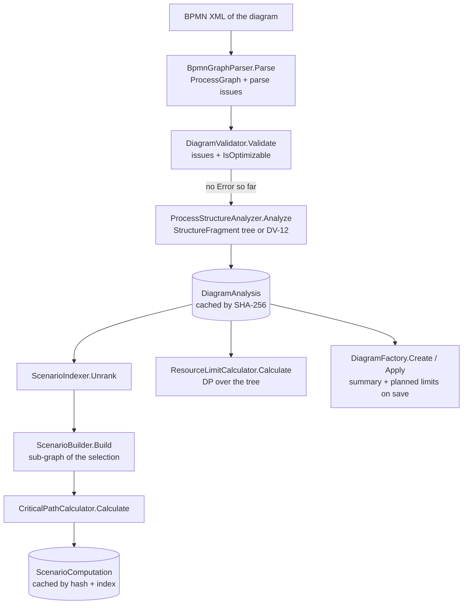

# Services

All services are in `ProjectOptimizerAPI/Lib/Service` and registered as **scoped** in `AddLocalServices()`. They
return DTOs, throw `ApiException` subclasses for rule violations, and commit at most once per call through
`IUnitOfWork`. The analysis components they use are singletons and are described in
[Analysis engine components](#analysis-engine-components) at the end of this file.

Messages quoted below are copied from the code.

## Shared helpers

### ProjectAccessGuard

`Lib/Service/ProjectAccessGuard.cs` · implements `IProjectAccessGuard` · depends on `IUnitOfWork`.

All project-scoped work goes through this class. In phase 2, the ownership check will be added here.

| Method | Purpose | Rules / errors |
|---|---|---|
| `GetProjectAsync(Guid projectId)` | Loads the **tracked** `Project` with `ProjectRepository.GetRequiredAsync(projectId)`. | 404 `"Project with id '<id>' was not found."` (IR-01) |
| `EnsureExistsAsync(Guid projectId)` | Checks existence with `ProjectRepository.ExistsAsync` without loading the row. | 404 `"Project with id '<id>' was not found."` (IR-01) |

### DiagramResolver

`Lib/Service/DiagramResolver.cs` · implements `IDiagramResolver` · depends on `IUnitOfWork`, `IProjectAccessGuard`.

| Method | Purpose | Rules / errors |
|---|---|---|
| `ResolveAsync(Guid projectId)` | Gets the project through the guard and loads its diagram with `DiagramRepository.FindAsync`. Returns `ResolvedDiagram(ProjectContext(projectId, timeUnit, currency), bpmnXml, contentSha256)`. | 404 unknown project · 404 `"The project has no diagram."` |

Every project is created with a diagram, so the second 404 only guards against inconsistent data.

### ScenarioCatalog

`Lib/Service/ScenarioCatalog.cs` · implements `IScenarioCatalog` · depends on `IDiagramResolver`, `IDiagramAnalyzer`.

This class owns BR-11 and BR-12, so `ScenarioService` never repeats those checks.

| Method | Purpose | Rules / errors |
|---|---|---|
| `GetOptimizableDiagramAsync(Guid projectId)` | `AnalyzeAsync`, then `EnsureOptimizable`. Returns `AnalyzedDiagram`. | 404 project · 409 `"The diagram has errors and cannot be analysed."` (BR-11) |
| `GetIndexedDiagramAsync(Guid projectId)` | `GetOptimizableDiagramAsync`, then `EnsureIndexable`. Returns `IndexedDiagram` with a `long` count. | + 409 `"The diagram has too many scenarios to index."` (BR-12) |

Private helpers and guards:

- `AnalyzeAsync(projectId)` resolves the diagram and runs `diagramAnalyzer.Analyze(sha256, xml)`, which is cached.
  It is not part of `IScenarioCatalog`. Besides the 404s from the resolver, the parser could throw 400 for stored XML
  that can no longer be parsed (this cannot happen for diagrams saved through the API).
- `EnsureOptimizable` (`HasOptimizableStructure`), `EnsureIndexable` (`IsIndexable`: count ≤
  9 007 199 254 740 991).

## ProjectService

`Lib/Service/ProjectService.cs` · implements `IProjectService` · depends on `IUnitOfWork`, `IProjectAccessGuard`,
`IDiagramFactory`, `TimeProvider`.

| Method | Purpose | Rules / errors |
|---|---|---|
| `ListProjectsAsync()` | Delegates to `ProjectRepository.ListAsync()`, which returns every project as `ProjectListItemDTO`, ordered by `UpdatedAt` descending, then `Id`. | – |
| `GetProjectAsync(Guid id)` | Projects the project to `ProjectDetailsDTO` (including the diagram summary). | 404 |
| `CreateProjectAsync(ProjectCreateDTO request)` | 1. Trims the name. 2. Checks that the normalised name is free. 3. Creates the project with `ProjectFactory.Create` (time unit default `Days`, currency default `EUR`, `CreatedAt = UpdatedAt = now`). 4. Sets `project.Diagram = diagramFactory.Create(project.Id, DefaultDiagram.Xml, project.CreatedAt)` (BR-05). 5. Commits with `SaveChangesOrConflictAsync`. 6. Returns the details. | 409 `"A project with this name already exists."` (BR-04), from the guard or from the unique index |
| `UpdateProjectAsync(Guid id, ProjectUpdateDTO request)` | 1. Loads the tracked project (404). 2. Trims and normalises the name. 3. Checks the name, excluding the project itself, so a rename to another casing is allowed. 4. Replaces `Name`, `NormalizedName`, `Description` (`null` clears it), `TimeUnit`, `Currency`. 5. Sets `UpdatedAt = now` (BR-15). 6. Commits. The diagram is not touched, so diagram numbers are not converted (BR-23). | 404 · 409 (BR-04) |
| `DeleteProjectAsync(Guid id)` | Loads the project, removes it and saves. The database cascades the deletion to the diagram (BR-16). | 404 |

Private guards and helpers:

- `EnsureNameIsAvailableAsync(normalizedName, excludedProjectId)` → `ConflictException(NameTakenMessage)`.
- `GetDetailsAsync(id)` → `ProjectRepository.GetRequiredAsync<ProjectDetailsDTO>(id)`.

## DiagramService

`Lib/Service/DiagramService.cs` · implements `IDiagramService` · depends on `IUnitOfWork`, `IProjectAccessGuard`,
`IDiagramFactory`, `IProcessJsonConverter`, `TimeProvider`.

Each project has exactly one diagram. Saving overwrites it in place; there is no history, no base-version check and
no optimistic concurrency (the last save wins).

| Method | Purpose | Rules / errors |
|---|---|---|
| `GetDiagramAsync(Guid projectId)` | Checks that the project exists, then projects its diagram to `DiagramDTO` (with the XML). | 404 project · 404 `"The project has no diagram."` |
| `SaveDiagramAsync(Guid projectId, DiagramSaveDTO request)` | Loads the tracked project (404), then `OverwriteAsync(project, request.BpmnXml)`. Semantic issues never block the save (BR-09). | 404 · 400 (BR-08, BR-17) |
| `SaveJsonDiagramAsync(Guid projectId, ProcessDiagram request)` | 1. Loads the tracked project (404). 2. `processJsonConverter.ToBpmnXml(request, project.TimeUnit, project.Currency)` builds the XML; structural problems (invalid or duplicate ids, bad type, two default branches) throw 400. 3. `OverwriteAsync(project, xml)`. | 404 · 400 (conversion, BR-08, BR-17) |
| `GetDiagramFileAsync(Guid projectId)` | Loads the project and its diagram. Returns `DiagramFileDTO { FileName = CreateFileName(project.Name), Content = xml }`. | 404 |

Private guards and helpers:

- `OverwriteAsync(project, bpmnXml)` 1. loads the **tracked** diagram with `DiagramRepository.FindAsync` (404 if
  missing), 2. calls `diagramFactory.Apply(diagram, xml, now)`, which parses and analyses the XML before changing any
  field (hard rejections throw 400 and leave the entity untouched), 3. sets `project.UpdatedAt = now` (BR-15),
  4. commits with `SaveChangesAsync()`, and 5. returns the saved diagram through `FindDtoAsync`.
- `EnsureFound<TDiagram>(diagram)` → `NotFoundException(ErrorMessages.DiagramNotFound)`.
- `CreateFileName(projectName)` trims the name and replaces every character from `Path.GetInvalidFileNameChars()`,
  `"` and `;` with `_`. It falls back to `diagram` when the result is empty, and appends `.bpmn`.

## ScenarioService

`Lib/Service/ScenarioService.cs` · implements `IScenarioService` · depends on `IScenarioCatalog`, `IDiagramAnalyzer`,
`IScenarioBuilder`, `IResourceLimitCalculator`.

All methods work on the project's current diagram.

| Method | Purpose | Rules / errors |
|---|---|---|
| `GetScenarioCountAsync(Guid projectId)` | Returns `ScenarioCountDTO { OrderingVersion = 1, Count }`. The count is read from the cached structure tree; no scenario is built. | 404 · 409 (BR-11) · 409 (BR-12) |
| `GetAllScenariosAsync(Guid projectId)` | Gets the indexed diagram. If the count is above `AnalysisLimits.MaxListedScenarios` (1000) it throws before building anything. Otherwise it builds every scenario from index 0 to `count − 1` exactly like `GetScenarioAsync` and returns them as `List<ScenarioDTO>` in index order. | 404 · 409 · 409 · 409 `"The diagram has more than 1000 scenarios; request them one by one."` (`ErrorMessages.TooManyScenariosToList`) |
| `GetScenarioAsync(Guid projectId, long index)` | Gets the indexed diagram, checks that the index is in range, builds the scenario (cached), and returns `scenarioBuilder.ToDto(computation, context, count)`. | 404 · 409 · 409 · 404 `"The scenario does not exist for this diagram."` (BR-30) |
| `GetResourceLimitsAsync(Guid projectId, ResourceLimitsQueryDTO query)` | Gets the optimizable diagram (BR-12 does **not** apply) and calls `resourceLimitCalculator.Calculate(graph, structure, basis ?? Planned, context)`. | 404 · 409 (BR-11) |

Private guards and helpers:

- `BuildScenario(indexed, index)` → `diagramAnalyzer.GetScenario` (cached) + `scenarioBuilder.ToDto`.
- `EnsureScenarioExists(indexed, index)` throws `NotFoundException(ErrorMessages.ScenarioNotFound)`.

## Analysis engine components

The engine is in `ProjectOptimizerAPI/Lib/Analysis`, and its in-memory records are in `Lib/Analysis/Model`. Its
components are pure, stateless, and registered as **singletons** in `AddAnalysisComponents()`. They never touch the
database. The only state is `IMemoryCache`, which `DiagramAnalyzer` owns.

### Limits (`AnalysisLimits`)

| Constant | Value | Used for |
|---|---|---|
| `MaxXmlBytes` | 2 × 1024 × 1024 (UTF-8 bytes) | BR-17, checked before parsing |
| `MaxFlowNodes` | 1000 | BR-17 |
| `MaxIndexableScenarios` / `MaxSafeInteger` | 9 007 199 254 740 991 (2^53 − 1) | BR-12 |
| `MaxInclusiveBranches` | 10 | DV-17 |
| `MaxListedScenarios` | 1000 | 409 limit of `GetAllScenariosAsync` |
| `MinBranchingFlows` | 2 | split/join detection |
| `OrderingVersion` | 1 | scenario order version in every DTO |
| `MaxSaveRequestBytes` | 3 × 1024 × 1024 | `[RequestSizeLimit]` on both save actions |
| `MaxPathCount` | 2^53 − 1 | saturation of `pathCount` |

### BpmnGraphParser

`IBpmnGraphParser.Parse(string bpmnXml) → ProcessGraph`. The parser runs these steps in order:

1. **Size.** If the XML is larger than 2 MB in UTF-8 bytes, it throws `InvalidRequestException`:
   `"The diagram XML must not be larger than 2 MB."`.
2. **Load.** It loads the XML with `XmlReaderSettings { DtdProcessing = Prohibit, XmlResolver = null }`. Any
   `XmlException` (malformed XML, DTD, XXE, billion laughs) becomes 400:
   `"The diagram is not well-formed XML or contains a DTD."`.
3. **Root.** The root must be `{http://www.omg.org/spec/BPMN/20100524/MODEL}definitions`. Otherwise it returns 400:
   `"The diagram root element must be a BPMN 2.0 definitions element."`. Namespace prefixes (`bpmn:`, `bpmn2:`,
   default namespace) do not matter.
4. **Flow-node limit.** It counts all flow-node elements at any depth under any `process`, including the content
   of sub-processes and unsupported node types. More than 1000 gives 400:
   `"The diagram must not contain more than 1000 flow nodes."`.
5. **Read the process.** Exactly one process is expected. If there are 0 or 2+, it reports DV-01, then reads the
   first process or returns an empty graph.

Only the **direct children** of the process become nodes:

| BPMN element (model namespace) | `EFlowNodeKind` |
|---|---|
| `startEvent` | `StartEvent` |
| `endEvent` | `EndEvent` |
| `task`, `userTask`, `manualTask`, `serviceTask`, `scriptTask`, `businessRuleTask`, `sendTask`, `receiveTask` | `Task` |
| `subProcess` (not `triggeredByEvent="true"`) | `SubProcess` |
| `callActivity` | `CallActivity` |
| `intermediateCatchEvent`, `intermediateThrowEvent` | `IntermediateEvent` |
| `exclusiveGateway` / `parallelGateway` / `inclusiveGateway` / `eventBasedGateway` | same-named kinds |
| `complexGateway`, `boundaryEvent`, `transaction`, `adHocSubProcess`, event sub-process | not a node; DV-04 |

The parser reads these values:

- **Durations and costs.** It reads `po:duration` and `po:cost` (namespace
  `http://projectoptimizer.app/schema/bpmn/1.0`) on every node. Values are parsed with `NumberStyles.Float` and the
  invariant culture, then normalised. A negative or unparsable value gives DV-09, and the value is treated as
  missing (0, `HasDuration` / `HasCost` = false).
- **`po:parallelizable`.** It is read only on activities. Only `true` and `false` are accepted (trimmed);
  otherwise DV-09 is reported and the value defaults to `true`. On non-activities the value is always `true`.
- **`extensionElements`.** The first `po:estimate` (`optimistic ≤ mostLikely ≤ pessimistic`, all present) and every
  `po:crashOption` (`duration` below the normal duration and `cost` not below the normal cost) are read. An invalid
  entry gives DV-09 and is dropped.
- **Sequence flows.** A `sequenceFlow` whose source or target is not a kept node reports one DV-05 per distinct
  missing reference, and the edge is dropped. `isDefault` is true when the source's `default` attribute equals the
  flow id. `conditionExpression` is kept as text.
- **Dependencies.** `DependsOn` and `Dependents` hold distinct, ordinal-sorted ids.
- **Gateway direction.** A gateway with ≤ 1 incoming and ≥ 2 outgoing flows is `Split`; one with ≥ 2 incoming and
  ≤ 1 outgoing flows is `Join`; anything else is `None`. Non-gateways are always `None`.
- **Controllable.** `IsControllable` is false only for `EventBasedGateway`.
- **Duplicate ids.** A duplicate node id keeps the first node.
- **Missing names.** A missing `name` becomes `""`.

### DiagramValidator

`IDiagramValidator.Validate(ProcessGraph) → DiagramValidationResult`. The validator merges the parse issues with
its own checks. The structure analysis runs only when no `Error` issue has been found yet. All issues are then
sorted by `Code`, `BpmnElementId` and `Message` (ordinal). `IsOptimizable` is true when there is no `Error` issue,
and `Structure` is non-null only in that case.

| Code | Severity | Owner (method) | Message (verbatim) | Element id |
|---|---|---|---|---|
| DV-01 | Error | `BpmnGraphParser` | `The diagram must contain exactly one process.` / `The process must not be empty.` | `null` / process id |
| DV-02 | Error | `CheckStartEventExists` | `The process has no start event.` | `null` |
| DV-03 | Error | `CheckEndEventExists` | `The process has no end event.` | `null` |
| DV-04 | Error | `BpmnGraphParser` | `The element type '<localName>' is not supported.` | element id |
| DV-05 | Error | `BpmnGraphParser` | `The sequence flow references the missing or unsupported flow node '<id>'.` | flow id |
| DV-06 | Error | `CheckReachableFromStart` (only when a start event exists) | `The node is not reachable from a start event.` | node id |
| DV-07 | Error | `CheckReachesEnd` (only when an end event exists) | `The node does not reach an end event.` | node id |
| DV-08 | Error | `CheckAcyclic` (nodes left over by Kahn's algorithm) | `The node is part of a cycle.` | node id |
| DV-09 | Error | `BpmnGraphParser` | `The value '<raw>' of po:duration\|po:cost must be a finite number greater than or equal to 0.` / `The value '<raw>' of po:parallelizable must be 'true' or 'false'.` / `The estimate must satisfy optimistic <= mostLikely <= pessimistic.` / `A crash option must be faster than the normal duration and not cheaper than the normal cost.` | node id |
| DV-10 | Warning | `CheckActivityEstimates` | `The activity has no po:duration or no po:cost; 0 is assumed.` | node id |
| DV-11 | Error | `CheckMixedGateways` | `The gateway has several incoming and several outgoing sequence flows; model it as two gateways.` | gateway id |
| DV-12 | Error | `ProcessStructureAnalyzer` | `The split has no matching join of the same type, or the region between them is not single-entry single-exit.` | split id (or `null`) |
| DV-13 | Warning | `CheckImplicitSplitsAndJoins` | `The node has several incoming or outgoing sequence flows and is interpreted as a parallel join or split; use an explicit parallel gateway.` | node id |
| DV-14 | Warning | `CheckIgnoredConditions` | `The condition is ignored because the sequence flow does not leave an exclusive or inclusive split.` | flow id |
| DV-15 | Warning | `CheckDuplicateNames` (non-blank names, case-sensitive) | `Several nodes share the name '<name>'.` | each node with the name |
| DV-16 | Warning | `BpmnGraphParser` | `The inner elements of the expanded sub-process are ignored.` | sub-process id |
| DV-17 | Error | `CheckInclusiveBranchLimit` | `An inclusive split may have at most 10 outgoing branches.` | gateway id |

The default diagram of a new project (a single start event) reports exactly one issue, DV-03, so it is not
optimizable.

### ProcessStructureAnalyzer

`IProcessStructureAnalyzer.Analyze(ProcessGraph) → StructureAnalysisResult`. It builds a single-entry single-exit
tree of `StructureFragment` records:

1. The nodes are sorted topologically with `TopologicalOrder.Sort`; a cycle gives DV-12 with element id `null`.
   The analyzer then adds a virtual source with arcs to every start event and a virtual sink with arcs from every
   end event.
2. It computes immediate post-dominators on this DAG.
3. A recursive descent walks a `Sequence` from the source to the sink. A node with ≥ 2 outgoing arcs opens a block.
   The block's join is the split's immediate post-dominator. Each branch must be a `Sequence` with a single entry
   that ends exactly at the join. The join's incoming-arc count must equal the split's outgoing-arc count, and the
   join kind must match:
   - `ExclusiveGateway` or `EventBasedGateway` split → `ExclusiveGateway` join.
   - `InclusiveGateway` split → `InclusiveGateway` join.
   - Parallel or implicit split → `ParallelGateway`, a non-gateway node, or the virtual sink.
4. Any violation gives one DV-12 issue and no tree.

The tree has these properties:

- Split and join nodes are `Leaf` fragments of the enclosing `Sequence`. The block fragment (`Parallel`,
  `Exclusive` or `Inclusive`) holds only the branches.
- Branches are ordered by `EntryNodeId` (ordinal), then by flow id.
- An empty branch (split → join) is a `Sequence` with no children whose `EntryNodeId` is the join id.
- Several start events or several end events form a virtual `Parallel` block.

`Count` is a `BigInteger`:

| Fragment | Count |
|---|---|
| `Leaf` | 1 |
| `Sequence`, `Parallel` | product of the children's counts |
| `Exclusive` | sum of the children's counts |
| `Inclusive` | ∏(1 + count(b)) − 1 |

### ScenarioIndexer and ScenarioKeyFormatter

`IScenarioIndexer` converts a scenario index into its choices, ordering version 1:

- **`Unrank(root, index)`** decodes the index in mixed radix. The last child is the least significant digit.
  - An `Exclusive` block assigns consecutive index ranges to its branches, in branch order.
  - An `Inclusive` block enumerates non-empty subsets by size, then lexicographically. Each subset is decoded like
    a `Parallel` block.
  - Choices are listed in pre-order: a block's own choice comes before the choices inside its chosen branches.
    `ChosenTargetIds` are the entry ids of the chosen branches, ordinal-sorted.

`ScenarioKeyFormatter.Format` joins the choices as `gatewayId=t1+t2;gatewayId2=t3`. Targets are ordinal-sorted. A
diagram without choices has the key `""`.

### ScenarioBuilder

`IScenarioBuilder`:

- **`Build(graph, selection)`** builds the scenario:
  1. Removes the outgoing edges of every chosen gateway whose target was not chosen.
  2. Runs a breadth-first search from all start events and keeps the reached nodes and the edges between them.
  3. Orders the nodes with `TopologicalOrder.Sort`; a cycle throws `InvalidOperationException`.
  4. Runs `CriticalPathCalculator`.

  The resulting `ScenarioComputation` contains:

  | Field | Content |
  |---|---|
  | `ElementIds` | Scenario nodes in topological order |
  | `SequenceFlowIds` | Sorted by the topological position of the source, then of the target, then by flow id |
  | `Activities` | Tasks, sub-processes and call activities, plus any other node with a duration or cost > 0 |
  | `CriticalPath` | Includes events and gateways |
  | `PathCount` | Source-to-sink paths, saturating at 2^53 − 1 |
  | `TotalDuration` | The makespan |
  | `SequentialDuration` | Sum of all node durations |
  | `TotalCost` | Sum of all node costs |
  | `HasExclusiveActivities` | Some scenario node has `po:parallelizable="false"` |
  | `HasMissingEstimates` | Some scenario activity lacks a duration or cost |

- **`ToDto(computation, context, count)`** adds the project-specific fields after the cache: `projectId`,
  `orderingVersion`, `count`, `timeUnit` and `currency`.

### CriticalPathCalculator

`ICriticalPathCalculator.Calculate(orderedNodes, edges) → CriticalPathResult` runs a standard CPM on the scenario
sub-graph. Events and gateways are kept as nodes with their own (usually 0) durations.

| Value | Rule |
|---|---|
| ES | max EF of the predecessors (0 for a source) |
| EF | ES + duration |
| Makespan | max EF over the sinks |
| LF | the makespan for sinks; otherwise min(LF − duration) over the successors |
| Slack | LS − ES |
| Critical | slack = 0 |

The critical path starts at the sink with the largest EF (ties: topological order). From each node it steps to a
critical predecessor whose EF equals the node's ES (ties: largest EF, then topological order), and the result is
then reversed. Duplicate edges count once.

### ResourceLimitCalculator

`IResourceLimitCalculator.Calculate(graph, root, basis, context) → ResourceLimitsDTO` runs a dynamic program over the
structure tree. Each metric is evaluated per fragment and memoised. Each metric remembers the selection (index and
choices) that reaches it, with ties broken towards the lowest index.

| Output | Leaf value | Parallel | Exclusive | Inclusive |
|---|---|---|---|---|
| `maxCost` | cost | sum | max branch | sum of branches with a positive value (first branch if none) |
| `minCost` | cost | sum | min branch | cheapest single branch |
| `maxCriticalPathDuration` | duration | longest branch | max branch | longest single branch |
| `minCriticalPathDuration` | duration | max over branches, at the lowest-index feasible selection | min branch | shortest single branch |
| `maxSequentialDuration` | duration | sum | max branch | sum of branches with a positive value |
| `maxExclusiveDuration` | duration of non-parallelizable nodes, 0 otherwise | sum | max branch | sum of branches with a positive value |

Sequences always sum their children. The other fields are derived:

- `maxDurationBound` = `maxCriticalPathDuration` + `maxExclusiveDuration`.
- With `basis = Pessimistic`, `estimate.pessimistic` replaces the duration wherever an estimate exists. Cost is
  unchanged.
- `isJointWorstCase` is true when the joint worst-case evaluation has the same duration as
  `maxCriticalPathDuration`. In that evaluation, an exclusive block takes the branch with the highest cost, then the
  highest duration; parallel and inclusive blocks sum the cost and take the max duration.
- `hasExclusiveActivities` and `hasMissingEstimates` consider every node of the graph.
- When the scenario count exceeds 2^53 − 1, `scenarioCount` and every `*Scenario` reference are `null`.
- `notes` can contain two fixed messages:
  - `"Some activities have no duration or cost; the limits may be too low."` when estimates are missing.
  - `"The diagram has too many scenarios to index; scenario references are omitted."` when the count is above the
    index limit.

For the worked example (`ProjectOptimizerTests/Fixtures/worked-example.bpmn`) the values are:

| Field | Value | Field | Value |
|---|---|---|---|
| `maxCost` | 25000 (index 1, `G3=F`) | `minCost` | 23000 (index 0, `G3=E`) |
| `maxCriticalPathDuration` | 21 (index 0) | `minCriticalPathDuration` | 20 (index 1) |
| `maxExclusiveDuration` | 4 | `maxDurationBound` | 25 |
| `maxSequentialDuration` | 29 (index 0) | `isJointWorstCase` | `false` |

### DiagramAnalyzer

`IDiagramAnalyzer` is the façade the services use:

| Method | Purpose |
|---|---|
| `Analyze(contentSha256, bpmnXml)` | Parse + validate, cached per hash. Returns a `DiagramAnalysis`. |
| `GetScenario(analysis, index)` | `Unrank` + `Build`, cached per hash and index. Throws `InvalidOperationException` when there is no structure or the index is out of range; services check both beforehand. |

### Caching

All entries live in the single `IMemoryCache` (`SizeLimit = 200 000`). Each entry sets a `Size`.

| Key | Value | Size | Sliding expiration |
|---|---|---|---|
| `scn-index:{ContentSha256}` | `DiagramAnalysis` | max(1, node count) | 30 min |
| `scn:{ContentSha256}:1:{index}` | `ScenarioComputation` | max(1, activity count) | 10 min |

Project-specific fields are added after the cache, so identical XML in different projects shares the
entries. Overwriting a diagram changes its hash; the old entries are no longer looked up and expire.

### ProcessJsonConverter

`IProcessJsonConverter.ToBpmnXml(ProcessDiagram diagram, ETimeUnit timeUnit, string currency) → string` (singleton,
stateless) turns the frontend's JSON export into BPMN XML for `SaveJsonDiagramAsync`. The input classes are in
`ProjectOptimizerLib/Model/Process/` (see [dtos-and-mapping.md](dtos-and-mapping.md#frontend-json-format)); code that
holds the export as a string reads it with `ProcessDiagram.Parse(json)`.

1. Validates ids (`XmlConvert.VerifyNCName`, unique across states and branches) and types (`^bpmn:[A-Z][A-Za-z]*$`).
2. Drops artifact types (text annotations, associations, lanes, …).
3. Maps each branch with `IsDefault` (type `nor`) to the `default` attribute of its source (at most one per source).
4. Writes `po:duration` / `po:cost` through `MetricTextConverter` (`Lib/Helper`), which converts `15m`, `1h 30m`,
   `25 EUR`, `€25` … to the project unit and currency and returns unreadable text unchanged, so `BpmnGraphParser`
   reports it as DV-09. The original texts go to `optimizer:time` / `optimizer:price` (`BpmnNamespaces.Frontend`)
   for the frontend's properties panel.
5. Generates `bpmndi` shapes and edges with `ProcessJsonLayout` (longest-path layering with Kahn's algorithm; nodes
   in cycles go into extra columns) and makes generated ids (`Process_1`, `*_di`, …) unique.

Other `branches[].type` values are ignored on purpose: the engine derives branching only from gateway types.

### DiagramFactory

`IDiagramFactory` has two methods:

- `Create(projectId, bpmnXml, updatedAt) → Diagram` builds a new entity; `ProjectService.CreateProjectAsync` uses it
  for the default diagram.
- `Apply(diagram, bpmnXml, updatedAt)` overwrites an existing entity; both diagram saves use it. It analyses the XML
  first and only then assigns the fields, so a hard rejection leaves the entity unchanged.

Both set these fields:

- `BpmnXml`, `UpdatedAt`.
- `ContentSha256` — lower-case hex.
- `SizeBytes` — UTF-8 byte count.
- `FlowNodeCount`, `ErrorCount`, `WarningCount`, `IsOptimizable` — from the analysis.
- `MaxCost`, `MaxDurationBound` — from a `Planned` resource-limit run when the analysis has an optimizable
  structure (also above the index limit); `null` otherwise.

These stored counts are the only place where validation results reach the client (through the diagram and project
DTOs). The issues themselves stay internal.

It throws only the parser's hard-rejection 400s (BR-08, BR-17). Semantic issues never block a save (BR-09).

### TopologicalOrder and GraphTraversal

- `TopologicalOrder.Sort(nodes, edges)` returns `null` when a cycle exists. `SortAcyclicPart` returns the nodes
  Kahn's algorithm could order.
  - Ready nodes are taken by priority: start events (rank 0), inner nodes (1), end events (2), then `bpmnId`
    ordinal.
  - Duplicate edges and edges to unknown nodes are ignored.
- `GraphTraversal.CollectReachable(seeds, neighbours)` is a breadth-first set of reached ids.
