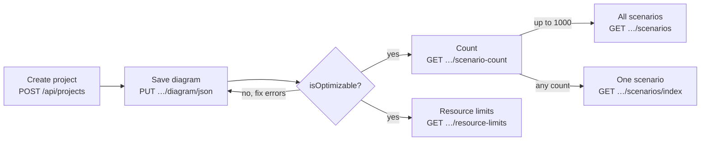

# Workflows

Task-oriented recipes in the order you usually meet them. `{projectId}` and other ids come from earlier responses;
the base URL is `http://localhost:5212`. There is no sign-in in phase 1.

---

## 1. Find a project

1. `GET /api/projects` → `data` is an array of all projects, the most recently updated first. There is no search
   or paging; filter the array on the client.
2. Take `data[i].id` → this is `{projectId}` for every other call.
3. `isOptimizable`, `maxCost` and `maxDurationBound` in the list already tell you whether the diagram is
   free of errors and what its worst cost and duration are.

## 2. Create a project and draw its first diagram

1. `POST /api/projects` with `{ "name": "Office move" }` (time unit defaults to `Days`, currency to `EUR`).
   → `data.id` is `{projectId}`; `data.diagram` is the default diagram (one start event, `errorCount` 1).
2. Draw the process in the frontend. Give tasks a `time` (`2d`, `1h 30m`, `3`) and a `price` (`100 EUR`, `€25`,
   `100`); decisions need an exclusive (or inclusive) gateway and a matching join gateway.
3. `PUT /api/projects/{projectId}/diagram/json` with the frontend export
   (body format in [diagram.md](endpoints/diagram.md#save-the-diagram-from-the-frontend-json-export))
   → 200, the diagram is overwritten, and `data.errorCount` / `data.warningCount` summarise the problems.
   - Alternatively save a BPMN XML with `po:` attributes through `PUT …/diagram`
     ([data-reference.md](data-reference.md#the-po-bpmn-extension)).
4. Continue with [recipe 4](#4-fix-diagram-problems) when `data.isOptimizable` is `false`.

## 3. Edit and save the diagram

1. `GET /api/projects/{projectId}/diagram` → `data.bpmnXml` is the current diagram.
2. Edit the diagram in the editor.
3. `PUT /api/projects/{projectId}/diagram/json` (or `PUT …/diagram` for XML).
   - **200** → the diagram is overwritten. There is no revision history and no concurrency check: if two tabs
     or users save, the last save wins.
   - **400** → the body cannot be turned into a diagram (invalid or duplicate id, bad state type, two `nor`
     branches from one state, XML too large / not well-formed / DTD / wrong root, > 1000 flow nodes); see
     [errors.md](errors.md#business-rule-and-request-errors).
4. Optional: `GET /api/projects/{projectId}/diagram/file` downloads the diagram as `<project name>.bpmn`.

## 4. Fix diagram problems

No endpoint lists the individual problems of the diagram; it only carries `errorCount`, `warningCount`
and `isOptimizable`.

1. Check the rules in [data-reference.md](data-reference.md#diagram-validation-codes) against the diagram. The
   usual errors are a missing start or end event (`DV-02`, `DV-03`), a node that is unreachable or does not reach
   the end (`DV-06`, `DV-07`), a cycle (`DV-08`), a `time`/`price` that could not be converted (`DV-09`), and a
   split without a matching join gateway (`DV-12`).
2. Fix every error; warnings are optional (for example `DV-10`: an activity without a duration or cost counts
   as 0).
3. If a value looks wrong, look at the `bpmnXml` of the diagram (`GET …/diagram`): `po:duration` and `po:cost`
   are what the API calculates with, `optimizer:time` and `optimizer:price` are the texts you sent.
4. Save again ([recipe 3](#3-edit-and-save-the-diagram)). When
   `isOptimizable` is `true`, the scenario endpoints work.

## 5. Explore the scenarios of a diagram

1. `GET /api/projects/{projectId}/scenario-count` → `data.count` (2 for the example in
   [getting-started.md](getting-started.md#3-first-calls)).
2. Then either:
   - `count` ≤ 1000: `GET /api/projects/{projectId}/scenarios` → an array of **all** scenarios in index order, each
     a full scenario (same shape as `GET …/scenarios/{index}`); above 1000 this call answers 409.
   - any `count`: `GET /api/projects/{projectId}/scenarios/{index}` one by one for `index` = 0 … `count − 1`.
3. Each scenario has `index`, `key`, `totalDuration`, `totalCost`, the activities with earliest/latest start and
   finish and slack, the `criticalPath`, and `elementIds` / `sequenceFlowIds` to highlight in the diagram. To find
   the cheapest or fastest scenario, sort on the client or use
   [recipe 6](#6-answer-at-most-how-long-at-most-how-expensive).

The scenario endpoints always use the current diagram. Indexes belong to one version of the diagram: after a
save, index 3 may be a different scenario. The `key` stays meaningful across saves.

## 6. Answer "at most how long, at most how expensive?"

1. `GET /api/projects/{projectId}/resource-limits` → `maxCost`, `minCost`, `maxCriticalPathDuration`,
   `minCriticalPathDuration`, `maxDurationBound`, `maxSequentialDuration`.
2. Each limit names the scenario that reaches it (`maxCostScenario.index`, …). Open it with
   `GET /api/projects/{projectId}/scenarios/{index}`.
3. For a risk view, repeat with `?basis=Pessimistic`: activities that have a `po:estimate` in the BPMN XML use
   its pessimistic duration.
4. Read `notes`: missing estimates mean the limits may be too low.

The project list and project details show `maxCost` and `maxDurationBound` of the diagram (planned
basis) without this extra call.

## 7. Change units or currency

1. `GET /api/projects/{projectId}` → current `name`, `description`, `timeUnit`, `currency`.
2. `PUT /api/projects/{projectId}` with **all four** fields (missing `description` clears it).
3. The numbers in the diagram are **not** converted: if durations were in days and you switch to `Hours`,
   re-enter them in the diagram and save it again. When you save the frontend JSON again, texts with a
   unit or currency (`2d`, `100 EUR`) are converted to the new settings; plain numbers are taken as they are, and
   an amount in the old currency becomes a `DV-09` error.
